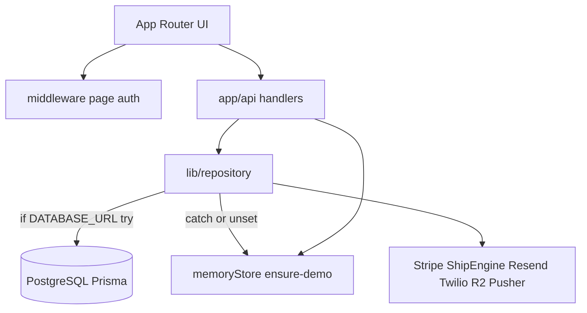
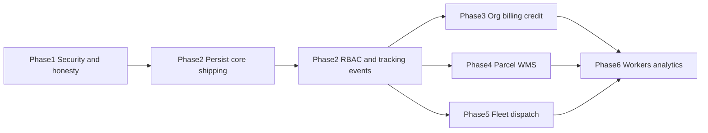

# NECO Ship Global — Complete UI Programme Report (Phases 0–7)

**Compiled:** 18 November 2026  
**Branch:** `integration/security-baseline`  
**HEAD (security baseline):** `a7cbdce` — impersonation removed / admin API permissions  
**Working tree:** UI Phases 1–7 local/uncommitted on top of security baseline  
**Deployment:** None. No commit/push/deploy from the UI programme sessions.

## Programme index

| Phase | Title | Document |
|-------|-------|----------|
| 0 | Complete Project Discovery and Technical Audit | `docs/phase-0-audit-report.md` |
| 1 | Unified Design System | `docs/ui-phase1/NECO-Ship-Global-UI-Phase-1-Design-System-Report.md` |
| 2 | Application Shells | `docs/ui-phase2/NECO-Ship-Global-UI-Phase-2-Application-Shells-Report.md` |
| 3 | Public Website & Customer Portal | `docs/ui-phase3/NECO-Ship-Global-UI-Phase-3-Public-and-Customer-Report.md` |
| 4 | Corporate Portal | `docs/ui-phase4/NECO-Ship-Global-UI-Phase-4-Corporate-Portal-Report.md` |
| 5 | Operations | `docs/ui-phase5/NECO-Ship-Global-UI-Phase-5-Operations-Report.md` |
| 6 | Super Admin, Finance & Reporting | `docs/ui-phase6/NECO-Ship-Global-UI-Phase-6-Admin-Finance-Report.md` |
| 7 | Final QA & Release Readiness | `docs/ui-phase7/NECO-Ship-Global-UI-Phase-7-Final-QA-Release-Readiness-Report.md` |

## Programme status snapshot

| Phase | Status |
|-------|--------|
| 0 Audit | Complete (read-only discovery) |
| 1 Design system | Complete locally |
| 2 Shells | Complete locally |
| 3 Public + customer | Complete locally |
| 4 Corporate | Complete locally |
| 5 Operations | Complete locally |
| 6 Admin + finance | Complete locally |
| 7 QA / release readiness | **READY FOR STAGING/PREVIEW REVIEW** (no Production deploy) |

---


---


## BEGIN PHASE DOCUMENT: phase-0-audit-report.md

# NECO Ship Global — Phase 0 Complete Project Discovery and Technical Audit

**Status:** Audit-only complete. No source, schema, env, or deployment changes made.  
**Baseline:** `main` @ `23fc233` · remote `https://github.com/lisagumbeze-oss/necoshipglobal.com.git`  
**Live site:** https://necoshipglobalcom.vercel.app/  
**Working tree:** Uncommitted local changes preserved (`.env.example`, `app/(public)/page.tsx`, `cookie-consent.tsx`, `hero-routes-visual.tsx`, `prisma/schema.prisma`, plus untracked `public/images/hero/`, `scripts/`).  
**Safe checks run:** `npm run typecheck` — **passed** (exit 0). No installs, migrations, or destructive tests.

---

## CRITICAL SECURITY FINDINGS (separate from backlog)

These are production-risk items. Treat as **blockers** ahead of feature development.

### SEC-CRIT-1 — Default administrator auto-creation (Critical)

- [`lib/repository/users.ts`](lib/repository/users.ts): `ensureSeedAdmin()` runs on **module import** and again on every `authenticateUser`; creates `admin@necoship.global` / `Admin123!` and `demo@necoship.global` / `Demo1234!` with **no `NODE_ENV` / production guard**.
- If `DATABASE_URL` is set and admin email is absent, `createUser` **inserts into PostgreSQL**.
- Existence check is against **memory only**, not the database.
- Same credentials in [`prisma/seed.ts`](prisma/seed.ts) and published in [`README.md`](README.md).
- **Live impact:** Login page exposes a **Mock role** switcher (`Guest` / `Customer` / `Admin`). Default credentials remain in shipped source; any deploy that loads the users module can recreate known admins. Treat live as **likely compromised or compromisable** until credentials are rotated, auto-seed removed, and sessions invalidated.
- **Required remediation (Phase 1):** Remove runtime auto-seed; seed only via explicit, gated CLI in non-prod; rotate/invalidate known passwords; remove credentials from README; strip RoleSwitcher from production builds; force re-login after secret rotation.

### SEC-CRIT-2 — Silent database → memory fallback (Critical)

- [`lib/db.ts`](lib/db.ts): `isDatabaseConfigured()` is only `Boolean(DATABASE_URL)` — no health check.
- Repositories (`users`, `shipments`, `auth-tokens`, `audit`) **catch Prisma errors and fall through to in-process `memoryStore`**.
- Production risk: split-brain reads/writes, lost data on cold start, auth/password resets against ephemeral memory, ops dashboards that already read **memory-only** appearing “healthy” while Postgres is down.
- **Required remediation:** Fail closed in production when DB is required; surface 503; never write operational state to memory when `DATABASE_URL` is set; alert on Prisma failures.

### SEC-CRIT-3 — Default NextAuth secret (Critical)

- [`lib/env.ts`](lib/env.ts) and [`middleware.ts`](middleware.ts): fallback `"dev-nextauth-secret"`.
- `missingProductionSecrets()` exists but is **never called** — no startup fail-fast.
- **Required remediation:** Refuse boot in production without strong `NEXTAUTH_SECRET` + `DATABASE_URL`; rotate secret and invalidate all JWTs.

### SEC-HIGH (additional)

| ID | Issue |
|----|--------|
| SEC-HIGH-1 | `mapRoleToAppRole`: any non-`CUSTOMER` Prisma role → full app `admin` ([`lib/repository/users.ts`](lib/repository/users.ts)) |
| SEC-HIGH-2 | Middleware excludes `/api/*`; auth is per-route only ([`middleware.ts`](middleware.ts)) |
| SEC-HIGH-3 | Auth OTP/verification codes returned in JSON when `RESEND_API_KEY` unset |
| SEC-HIGH-4 | Carrier webhook `POST /api/webhooks/carriers` unauthenticated |
| SEC-HIGH-5 | Stripe webhook simplified / weak signature verification in dev path |
| SEC-HIGH-6 | OpenAPI claims `X-API-Key`; `requireSession` does not enforce API keys |
| SEC-MED-1 | `Math.random()` for auth tokens ([`lib/auth-tokens.ts`](lib/auth-tokens.ts)) |
| SEC-MED-2 | Demo fixtures (`ensure-demo`, fake API key hashes, webhook secrets) in authenticated flows |

**Do not publish** demo passwords in customer-facing materials. Credentials already appear in README/source — rotate assuming public knowledge.

---

## REPORT 1 — Executive Summary

**Condition:** Mature **UI prototype / design-system showcase** of an international logistics platform, not an operational TMS/WMS/fleet/billing system. ~65 API routes and ~65 App Router pages; Prisma schema (~38 models) is substantially richer than runtime persistence.

**Assessment:** Architecture choices (Next.js 14 App Router, Prisma 5.22, PostgreSQL, NextAuth, Zod, Tailwind, adapter pattern for Stripe/ShipEngine/etc.) are appropriate to retain. The gap is **persistence, RBAC, and operational domain wiring**, not framework selection.

**Strengths**

- Broad product surface: marketing, shipper dashboard, admin ops UI.
- Official NECO branding centralized (`#062853` / `#F8E000`) in [`lib/brand.ts`](lib/brand.ts).
- Meaningful schema foundation: Shipment, Package, TrackingEvent, Org, Warehouse*, DriverProfile, Invoice, Claim.
- Integration adapters with graceful local fallbacks when keys absent.
- Typecheck currently clean.

**Weaknesses**

- Default truth store is [`memoryStore`](lib/repository/memory-store.ts) + [`ensure-demo.ts`](lib/repository/ensure-demo.ts).
- Most domain APIs never touch Prisma even when DB is configured.
- No automated tests.
- Marketing claims (certs, stats, hubs, SaaS pricing) are placeholder and live on production.
- Package name still `swiftship-global`; dual domains (`necoshipglobal.com` vs `necoship.global`).

**Critical concerns:** SEC-CRIT-1/2/3; memory-backed ops data on serverless; unverified public claims; subscription pricing vs confirmed negotiated-credit B2B model.

---

## REPORT 2 — Technology Stack (actual)

| Layer | Technology | Version |
|-------|------------|---------|
| Frontend | Next.js App Router, React, TypeScript, Tailwind, Framer Motion, Sora/DM Sans | Next `^14.2.15`, React `^18.3.1`, TW `^3.4.13`, TS `^5.6.3` |
| Backend | Next.js Route Handlers (same app) | — |
| ORM / DB | Prisma + PostgreSQL | Prisma `5.22.0` |
| Auth | NextAuth credentials + optional Google; TOTP via otplib | `next-auth ^4.24.7` |
| Validation | Zod | `^3.23.8` |
| Payments | Stripe (adapter + local fallback) | `^17.7.0` |
| Carriers | ShipEngine (adapter + local rates) | env-gated |
| Maps / RT / mail / SMS / storage | Mapbox, Pusher, Resend, Twilio, R2/S3 SDK | optional |
| Testing | **None** | — |
| Deploy | Vercel (live); no `vercel.json`; `next.config.js` minimal | — |
| Package manager | npm (`package-lock.json`) | — |
| Package name | `swiftship-global` (legacy) | `1.0.0` |

---

## REPORT 3 — Repository Structure

```
app/(public)/     Marketing + quote/tracking/legal
app/(auth)/       Login, register, forgot-password, 2FA
app/(dashboard)/  Shipper + prototype /driver
app/(admin)/admin Ops console pages
app/api/**        ~65 Route Handlers
components/       design-system, public, brand, maps, providers
lib/auth*.ts      NextAuth, middleware helpers, tokens
lib/repository/   users, shipments, memory-store, ensure-demo
lib/services/     carriers, payments, wms, email, sms, realtime, audit…
prisma/           schema.prisma, seed.ts
public/brand/     Official logos
public/openapi.json  Partial API spec
```

**Entry points:** `app/layout.tsx` → route groups; auth gate in `middleware.ts` (pages only); data via `lib/repository/*` and `memoryStore`.



---

## REPORT 4 — Existing Feature Matrix

Status: A fully tested · B implemented untested · C partial · D mocked · E missing · F broken

| Feature | Status | Evidence | Recommended action |
|---------|--------|----------|-------------------|
| Authentication | C | NextAuth + hybrid users; prod demo seed | Harden (P0 security) |
| Registration / verify | C | APIs exist; weak verify UX | Complete + email-required in prod |
| Profiles | C | PATCH settings memory-only | Persist to Prisma User |
| Quotations | C/D | Quote API; memory; local/ShipEngine rates | Persist quotes; org rate cards |
| Shipment booking | C | Hybrid `bookShipment`; Package rows often not created | Full Prisma path + packages |
| Tracking | C | Public API; no provenance/dedupe; no live subscribe | Extend TrackingEvent |
| Multi-track | C | Up to 10 IDs | Keep; add rate limits |
| Pickup scheduling | D | Public page client id; admin memory | Wire Pickup + driver assign |
| Warehouse | D | SKU WMS in memory | Parcel custody model |
| Fleet / vehicles | E | No Vehicle model | New domain (extend carefully) |
| Drivers | D | Demo roster; schema DriverProfile unused by APIs | Bind to User + assignments |
| Dispatch | D | UI toast only | DeliveryAssignment APIs |
| POD | C | Memory + tracking event | Persist ProofOfDelivery |
| Corporate accounts | D | Org API memory; member userId bug | Org-first billing |
| Negotiated pricing | D | Rate cards/rules memory | Contract + RateCard relation |
| Credit accounts | D | creditLimit fields; no enforcement | CreditTerms + holds |
| Invoicing / payments | D | Memory invoices; User-scoped schema | Org invoices + aging |
| Claims / support | C | Memory tickets/claims | Persist + workflows |
| Notifications | D | Memory + adapters | Persist + channels |
| Admin dashboard | C | Rich UI on demo data | Back with Postgres |
| Staff management | D | GET-only fixtures | Real RBAC |
| Integrations | C | Adapters with stubs | Env-gated prod config |
| Reporting | D | Fixture series | Real aggregates |
| Automated tests | E | Zero test files | Introduce vitest + API tests |

---

## REPORT 5 — UI/UX Audit

**Live observations:** Homepage, About, Quote, Tracking, Locations, Login, OpenAPI, dashboard gate inspected.

**Strengths:** Consistent navy/yellow brand; Sora typography; sticky public nav; quote wizard; multi-track UI; cookie consent; Framer Motion; design-system primitives.

**Weaknesses / live issues:**

- Placeholder stats/certs/testimonials/SaaS pricing ($49/$129) on production homepage.
- Sample hubs presented as real network; contact geography inconsistent (e.g. Johannesburg vs locations list).
- **Mock role** switcher on live login — prototype UX in production.
- Dense public nav; duplicate homepage footers; undefined `brand-dark` token referenced.
- Maps often placeholder (not Mapbox-backed on locations/about).
- i18n scaffolding unused; English-only UI.
- Homepage animated counters can show broken values (e.g. `-0.0 M+`, `0 +`) during/after animation.

**Preserve branding:** Navy `#062853`, Yellow `#F8E000`, white/neutrals — already in `lib/brand.ts`. Do not publish unverified partnerships, stats, testimonials, or coverage.

---

## REPORT 6 — Database and API Audit

### Entities present (Prisma)

User, Account, Session, VerificationToken, Organization, OrganizationMember, CostCenter, Address, Quote, Shipment, Package, TrackingEvent, ProofOfDelivery, Exception, CustomsClearance, Pickup, DriverProfile, StaffProfile, RateCard, Surcharge, PromoCode, Invoice, InvoiceItem, Payment, Document, Ticket*, Notification*, ApiKey, Webhook*, AuditLog, Claim, BlogPost, WarehouseLocation/Bin/InventoryItem/Movement, CarrierIntegration, CarrierInvoice, SystemLog.

### Missing / incomplete for NECO ops

- **Fleet:** Vehicle, VehicleCategory, DriverVehicleAssignment, MaintenanceRecord, FuelExpense, Route/Stop, DeliveryAssignment, VehicleLocation.
- **Corporate:** Contract, CreditTerms, Statement, InvoiceApproval, org-scoped Invoice/Payment; RateCard↔Organization relation missing despite `organizationId` scalar.
- **Warehouse custody:** Package↔bin custody, PackageScan, Receiving, Transfer, DispatchManifest (EOD manifest is memory-only).
- **Tracking:** source, actorUserId, packageId, idempotencyKey on TrackingEvent.

### API reality

- **65** implemented routes; OpenAPI documents **~14** path groups — large under-documentation; overstated API-key auth.
- Prisma used mainly for users/shipments/tokens/audit/GDPR; quotes, invoices, warehouse, drivers, orgs, POD, tickets mostly **memory**.

---

## REPORT 7 — Fleet and Operations Gap Analysis

**Reusable now:** `DriverProfile`, `Pickup.driverId`, `WarehouseLocation`, `Shipment`/`Package`/`TrackingEvent`, `ProofOfDelivery`, `Exception`, staff UserRole enum values (underused).

**Do not duplicate:** Keep DriverProfile as the driver entity; extend Pickup rather than invent parallel “collection” entities; use TrackingEvent as the audit spine for operational milestones.

**Must add for own-fleet network:**

1. Vehicle registration/docs/categories/ownership/availability  
2. Driver↔vehicle assignment  
3. Maintenance/inspections  
4. Route/stop allocation + delivery assignments  
5. Fuel/operating costs (optional Phase 2+)  
6. Vehicle location (manual now; telematics later via event ingest)  
7. Utilization reports  

**Status distinctions (recommended):**

| Domain | Owner of truth |
|--------|----------------|
| Shipment status | Aggregate from packages + milestones |
| Package status | Scan/custody events |
| Vehicle status | Fleet availability/maintenance |
| Driver status | Duty/assignment on DriverProfile |
| Delivery status | DeliveryAssignment + POD attempts |

**Event ingest architecture:** Authorized staff actions, warehouse scans, delivery POD, carrier webhooks, and future telematics all write **TrackingEvent** (or linked PackageScan) with `source`, `actorUserId`, `idempotencyKey`; validate allowed status transitions; publish via Pusher optionally.

**GPS:** No telematics today — plan event-compatible `VehicleLocation` later; do not block Phase 1 on GPS vendors.

---

## REPORT 8 — Commercial and Financial Gap Analysis

**Confirmed model:** Negotiated corporate rates, contracts, credit terms — **not** public SaaS subscription as default.

**Exists:** Organization (+ creditLimitCents), RateCard (orphan org id), Invoice/Payment **per User**, demo wallet/auto-pay, memory rate-rules, homepage Enterprise “credit terms” teaser.

**Missing:** Contracts with validity; org rate lists; credit terms/limits enforcement at booking; credit holds; invoice approvals; aging/dunning; statements; credit notes; org-consolidated invoicing.

**Subscription pricing ($49/$129):** Recommend **remove from public homepage** or reposition as “platform access for API shippers” only after business confirmation — default commercial UX should be **Get a Quote / Talk to enterprise**, not monthly plans.

**Individual customers:** No corporate credit by default — keep prepaid/card/wallet separate from org credit accounts.

---

## REPORT 9 — Security and Deployment Audit

Covered in **Critical Security Findings** above.

**Infrastructure:**

- Vercel serverless suitable for web/API request/response; **not** ideal alone for long-running dispatch, scheduled invoicing, webhook retries, telematics ingest.
- Recommend: keep Next.js on Vercel; add managed Postgres (required in prod); queue/worker (e.g. Inngest/Trigger/Cloud Tasks + `lib/jobs`) for manifests, billing cycles, webhook delivery; R2 for files; Pusher for live updates.
- No evidence in-repo of backup/monitoring config — treat as open ops question.
- Per-instance memory store is **unsafe** on multi-instance Vercel.

**Env requirements:** See [`.env.example`](.env.example) — DATABASE_URL, NEXTAUTH_*, Stripe, ShipEngine, Mapbox, Resend, Twilio, R2, Pusher. Do not assume live keys are configured.

---

## REPORT 10 — Recommended Architecture (retain stack)

Retain Next.js 14 + Prisma + Postgres + NextAuth + Zod + existing adapters.

**Target layers:**

1. **Fail-closed data access** — Prisma repositories only in production; delete silent memory fallback when DB configured.  
2. **RBAC** — map Prisma `UserRole` + `StaffProfile.permissions` to fine-grained abilities (not binary admin).  
3. **Operational event bus** — TrackingEvent + PackageScan as system of record.  
4. **Org commercial core** — Contract → RateCard → Shipment → Org Invoice → Payment/Statement.  
5. **Fleet module** — Vehicle + assignments beside existing DriverProfile/Pickup.  
6. **Parcel WMS** — custody on Package, not only SKU InventoryItem.  
7. **Workers** — scheduled billing, webhook delivery, reconciliation off-request-path.

**Recommended internal roles (assessed):**

| Role | Maps from / notes |
|------|-------------------|
| Super Administrator | `ADMIN` — break-glass only |
| Operations Manager | `OPS_MANAGER` |
| Warehouse Manager | **add** (or permission set) |
| Warehouse Staff | **add** |
| Dispatcher | **add** (or OPS subset) |
| Delivery Agent | `DRIVER` + DriverProfile |
| Finance Officer | `FINANCE` |
| Customer Support Agent | `SUPPORT_AGENT` |
| Customs Officer | `CUSTOMS_OFFICER` (keep) |
| Read Only | `READ_ONLY` |

External: Individual customer, Corporate (org members: ORG_ADMIN / SHIPPER / BILLING / VIEWER), Recipient (token portal).

---

## REPORT 11 — Prioritized Development Backlog

### P0 — Critical (security & data integrity)

| Feature | Problem | Solution | Deps | Acceptance | Size | Risk |
|---------|---------|----------|------|------------|------|------|
| Remove auto admin seed | Known prod admin | Delete `ensureSeedAdmin` boot path; gated seed CLI only | — | No auto admin in prod; known passwords rotated | S | High if skipped |
| Enforce secrets | Weak JWT / no DB | Fail boot if missing `NEXTAUTH_SECRET`/`DATABASE_URL` in prod | — | App refuses start without secrets | S | High |
| Kill memory fallback in prod | Split-brain | Error 503 on Prisma failure when DB required | secrets | No silent memory writes in prod | M | High |
| Strip demo UI | Mock role live | Remove RoleSwitcher outside development | — | Login has no mock role in prod | S | Med |
| Rotate & invalidate | Exposed creds/secret | Password resets + NEXTAUTH_SECRET rotation | secrets | Old sessions invalid | S | High |
| Auth token CSPRNG | Weak OTP | `crypto.randomBytes` | — | Tokens use CSPRNG | S | Med |

### P1 — High (platform foundation)

| Feature | Problem | Solution | Size |
|---------|---------|----------|------|
| Persist core domains | Memory APIs | Repository rewrite: quotes, packages, POD, pickups, orgs, invoices | L |
| Real RBAC | Binary admin | Role→permission middleware for pages + APIs | M |
| TrackingEvent provenance | No audit | source, actor, packageId, idempotency, transition rules | M |
| Org billing v1 | User invoices only | organizationId on Invoice; credit check at book | L |
| Marketing claim cleanup | Unverified public claims | Remove stats/certs/SaaS tiers/fake hubs or mark TBD | M |
| OpenAPI + API keys | Spec lies | Sync spec; implement or drop X-API-Key | M |
| Test harness | Zero tests | Vitest for auth/repos + critical API routes | M |

### P2 — Medium (ops expansion)

Fleet vehicles/assignments, parcel WMS custody/scans, manifests dispatch, statements/aging, staff CRUD, webhook worker, live tracking subscribe.

### P3 — Low

Fuel analytics, telematics, i18n activation, CMS polish, utilization BI, advanced reconciliations.

---

## REPORT 12 — Phase 1 Implementation Proposal

**Do not start until project owner explicitly approves.**

### Objectives

1. Eliminate critical security defects on live deployment.  
2. Make production **Postgres-only** for authenticated/operational data.  
3. Remove prototype affordances and unverified commercial claims from public site.  
4. Establish RBAC skeleton and tracking event contract for later fleet/WMS/billing phases.

### In scope

- SEC-CRIT-1/2/3 and related HIGH auth hardening.  
- Production boot validation; session invalidation procedure.  
- Remove/hide RoleSwitcher, README credentials, demo password paths.  
- Public content hygiene: stats, certifications, testimonials, subscription teaser, sample locations disclaimers or removal.  
- Fix `brand-dark` token / footer.  
- Introduce minimal test suite for auth seed absence + fail-closed DB behavior.  
- Document runbooks: admin provisioning, secret rotation, env checklist.

### Out of scope (later phases)

- Full fleet module, parcel WMS, complete org credit/aging, telematics, subscription product decisions beyond removing misleading homepage tiers.

### Technical dependencies

- Confirmed production `DATABASE_URL` and ability to rotate `NEXTAUTH_SECRET` on Vercel.  
- Owner-approved admin provisioning method (invite / CLI one-shot).  
- Decision on whether demo accounts may exist in non-prod only.

### Database preparation

- No broad schema expansion required for Phase 1 security.  
- Plan migration **only if** adding columns for TrackingEvent provenance early; otherwise defer to Phase 2.  
- Manual: delete/rotate known admin/demo users in prod DB after deploy.

### Security considerations

- Assume default passwords public; force reset.  
- Disallow OTP leakage without Resend in production.  
- Sign carrier/Stripe webhooks before enabling in prod.

### Development tasks (milestone-sized)

1. Security patch PR (seed, secrets, fallback, role switcher, CSPRNG).  
2. Vercel env audit + secret rotation (ops).  
3. Marketing/content honesty PR.  
4. Auth/RBAC skeleton PR (stop non-CUSTOMER → full admin).  
5. Smoke tests + typecheck/lint gate.

### Testing strategy

- Unit: `missingProductionSecrets`, no `ensureSeedAdmin` in production mode, repository throws when DB down in prod.  
- Manual: login, register, tracking GET, admin denied for customer.  
- No dependency installs beyond existing tooling if possible; add vitest only with approval.

### Phase 1 acceptance criteria

- [ ] Production build fails or refuses traffic without `DATABASE_URL` + strong `NEXTAUTH_SECRET`.  
- [ ] No automatic creation of default admin/demo users.  
- [ ] Known default credentials cannot authenticate (rotated/removed).  
- [ ] No Mock role control on production login.  
- [ ] Prisma failures do not write to memory in production.  
- [ ] Public homepage does not show unverified certs/stats/SaaS prices (or clearly non-claim disclaimers per owner).  
- [ ] Typecheck passes; critical unit tests pass.  
- [ ] Owner sign-off before Phase 2 (persistence / fleet / billing).

---

## REPORT 13 — Open Business Questions

Architecture-affecting only:

1. **Admin provisioning:** Who is the first Super Admin, and by what secure process?  
2. **Production database:** Is Postgres already attached on Vercel? Who operates backups?  
3. **Own-fleet scope v1:** Which countries/hubs are real vs future? Which vehicle categories first?  
4. **International linehaul:** Carrier partners vs NECO-operated segments — what must the system orchestrate vs track only?  
5. **Corporate credit:** Standard terms (Net 15/30/45), who approves limits, who approves invoices?  
6. **Individual vs corporate UX:** Keep consumer shipper flows or prioritize B2B-only initially?  
7. **Subscription tiers:** Remove entirely, or retain as optional API platform fee separate from freight?  
8. **Real facilities:** Confirm or replace LAX/FRA/DXB/SIN/ORD and Johannesburg contact claims.  
9. **Certifications:** Any real credentials that may be published?  
10. **Currency / legal entity / tax:** Invoicing currency, VAT/tax handling, contracting entity name (“Neco Ship Global” vs product name).  
11. **Background jobs host:** Preferred worker platform alongside Vercel?  
12. **Uncommitted local work:** Should WIP hero/cookie/schema changes be merged before Phase 1 security PR?

---

## Scrum sequence (recommended)



**Must-have before go-live as logistics platform:** P0 security, Postgres persistence for shipments/packages/tracking/users/orgs, RBAC, org invoicing basics, pickup/delivery assignment MVP.  
**Later:** Full WMS, fleet maintenance/fuel, telematics, advanced reconciliation.

---

## Phase 0 completion checklist

- [x] Repository inspected  
- [x] Live website assessed (public routes + auth gate; no unauthorized credential use)  
- [x] Feature matrix classified  
- [x] Stack identified  
- [x] Database/API assessed  
- [x] Fleet/logistics gaps evaluated  
- [x] Corporate pricing/invoicing evaluated  
- [x] Security/infrastructure reviewed  
- [x] Prioritized backlog created  
- [x] Phase 1 proposal presented  
- [x] Open questions documented  

**STOP:** Awaiting explicit project owner approval before any Phase 1 implementation.

## END PHASE DOCUMENT: phase-0-audit-report.md


---


## BEGIN PHASE DOCUMENT: NECO-Ship-Global-UI-Phase-1-Design-System-Report.md

# NECO Ship Global — UI Phase 1 Design System Report

**Date:** 18 November 2026  
**Branch:** `integration/security-baseline` (local uncommitted UI work)  
**Scope:** Foundational NECO Ship Global design system (tokens, primitives, patterns)  
**Security:** No changes to authentication, RBAC, middleware, APIs, or schema.

---

## Verdict

Phase 1 established the shared visual and component foundation used by Phases 2–7. Navy `#062853` / yellow `#F8E000` brand tokens, typography, spacing, and reusable UI primitives were implemented under `components/design-system/` and wired through Tailwind / CSS variables. Typecheck and isolated builds in later phases continued to consume this system. Not committed, pushed, or deployed as a standalone release.

---

## Delivered foundation

| Area | Location / notes |
|------|------------------|
| Brand tokens | Tailwind + CSS `--ns-*` / brand navy & yellow |
| Primitives | `Button`, `Input`, `Card`, `Badge`, `KpiCard`, `ChartContainer`, form fields |
| Page patterns | `PageHeader`, `Breadcrumbs`, `Tabs`, `FilterBar` |
| Data display | `DataTable`, `Pagination`, `RowActions` |
| Feedback | `EmptyState`, `ErrorState`, `Skeleton`, `AlertBanner`, `ToastFrame` |
| Overlays / timeline | `Modal`, `Drawer`, `Timeline` |
| Barrel export | `components/design-system/index.ts` |

---

## Constraints observed

- No new animation or chart libraries beyond existing Framer Motion / project stack.
- Accessibility: focus-ring, min touch targets, tone-based status badges.
- Existing routes unchanged; Phase 1 is a dependency layer for subsequent UI phases.

---

## Verification (as of Phase 7 re-check)

Consumed successfully by public, customer, corporate, operations, and admin surfaces. Lint residual: `aria-sort` on DataTable sort buttons (Phase 7 D1).

---

*End of Phase 1 report (retrospective documentation of delivered work).*

## END PHASE DOCUMENT: NECO-Ship-Global-UI-Phase-1-Design-System-Report.md


---


## BEGIN PHASE DOCUMENT: NECO-Ship-Global-UI-Phase-2-Application-Shells-Report.md

# NECO Ship Global — UI Phase 2 Application Shells Report

**Date:** 18 November 2026  
**Branch:** `integration/security-baseline` (local uncommitted UI work)  
**Scope:** Shared application chrome for customer, corporate, operations, and admin experiences  
**Security:** Shells filter navigation by session permissions where applicable; no RBAC/API/middleware edits. No impersonation.

---

## Verdict

Phase 2 introduced the shared shell system (`components/shell/app-chrome.tsx`) and portal-specific shells so all authenticated experiences share consistent navigation, headers, mobile drawers, and bottom nav. Preview routes (`*-preview`) were established as development-only (404 in production). Not committed, pushed, or deployed as a standalone release.

---

## Delivered shells

| Shell | Primary routes | Notes |
|-------|----------------|-------|
| `CustomerShell` | `/dashboard`, customer app routes | Preview: `/customer-preview` |
| `CorporateShell` | `/corporate/*` | Preview: `/corporate-preview` |
| `OperationsShell` | `/operations/*`, `/dispatch/*`, `/fleet/*`, `/warehouses/*`, `/deliveries/*` | Preview: `/operations-preview` |
| `AdminShell` | `/admin/*` | Preview: `/admin-preview`; permission-filtered nav; “No impersonation” meta |

Shared primitives: `ShellFrame`, `ShellHeader`, `ShellSidebarBrand`, `ShellNavGroups`, `ShellMobileDrawer`, `ShellBottomNav`, `AccountMenu`, active-route helpers (`isShellNavActive` — covered by `tests/security/shell-nav.test.ts`).

---

## Constraints observed

- Auth gates remain in middleware; shells are presentation + nav filtering only.
- Preview routes intentionally excluded from protected pathname matchers and return `notFound()` when `NODE_ENV === "production"`.
- RoleSwitcher remains development-oriented and production-guarded per security tests.

---

## Verification (as of Phase 7 re-check)

Shell nav active-state unit tests pass. Preview production guards present on all 15 preview pages. Protected routes still redirect unauthenticated users to login.

---

*End of Phase 2 report (retrospective documentation of delivered work).*

## END PHASE DOCUMENT: NECO-Ship-Global-UI-Phase-2-Application-Shells-Report.md


---


## BEGIN PHASE DOCUMENT: NECO-Ship-Global-UI-Phase-3-Public-and-Customer-Report.md

# NECO Ship Global — UI Phase 3 Public and Customer Report

**Date:** 18 November 2026  
**Branch:** `integration/security-baseline` (local uncommitted UI work)  
**Scope:** Public website redesign (UI-19) + individual customer portal (UI-15 / UI-08 / UI-42 / UI-14)  
**Security:** No changes to authentication, RBAC, middleware, session handling, API authorization, database schema, or repository logic.

---

## Verdict

Phase 3 is complete locally. Public homepage and key marketing pages share the Phase 1 design language with a full-bleed UI-19 hero. Customer dashboard, shipment register, and shipment detail use demonstration fixtures with explicit labels — no fabricated ratings, GPS movement, wallet balances, or unverified operational claims. Typecheck, isolated production build, and Vitest (58/58) passed. Not committed, pushed, or deployed.

---

## Screenshots

Stored under `docs/ui-phase3/`:

| File | Subject |
|------|---------|
| `01-home-mobile-390.png` | Homepage hero at ~390px — brand, dual CTAs, tracking card |
| `02-home-desktop-hero.png` | Homepage hero with primary nav + Get a Quote / Track Shipment |
| `03-customer-dashboard-ui15.png` | Customer overview — KPIs, activity chart, demo banners |
| `04-shipments-register-ui08.png` | Shipment register — search + table |
| `05-shipment-detail-mobile-ui14-42.png` | Detail mobile hierarchy — milestone, actions, demo notice |

Preview routes used for customer screenshots (dev-only, 404 in production; do not bypass `/dashboard` auth):

- `/customer-preview`
- `/customer-preview/shipments`
- `/customer-preview/shipments/NS-DEMO-100481`

---

## Route list (retained)

### Public

| Route | Notes |
|-------|--------|
| `/` | UI-19 hero redesign |
| `/about` | Design-system page chrome |
| `/services` | Service cards + CTA |
| `/tracking` | Existing API tracking retained |
| `/quote` | Existing multi-step form retained |
| `/contact` | Existing form retained |
| `/faq` | Shared public page pattern |
| `/locations` | Demo-labelled location pins |
| `/resources` | Resource grid |
| `/support` | Support topic cards |
| `/terms`, `/privacy`, `/cookies` | Unchanged legal |
| Other public utility pages | Routes remain available |

### Customer (auth-protected; unchanged route paths)

| Route | Notes |
|-------|--------|
| `/dashboard` | UI-15 overview |
| `/shipments` | UI-08 register |
| `/shipments/[trackingId]` | UI-42 detail + UI-14 mobile hierarchy |
| Other dashboard routes | Shell navigation unchanged |

### Dev-only preview (new)

| Route | Notes |
|-------|--------|
| `/customer-preview` (+ shipments) | Local UI review only |

---

## Changed files (Phase 3 focus)

### Public

- `app/(public)/page.tsx` — full-bleed hero, dual CTAs, services / how-it-works / corporate / contact
- `app/(public)/about/page.tsx`, `services/page.tsx`, `faq/page.tsx` — shared public chrome
- `app/(public)/tracking/page.tsx`, `quote/page.tsx`, `contact/page.tsx`, `locations/page.tsx`, `resources/page.tsx`, `support/page.tsx` — design-language alignment; forms/APIs kept
- `components/public/public-page.tsx` — `PublicPage`, `PublicSection`, `PublicPageHeader`, `PublicCtaBand`

### Customer portal

- `app/(dashboard)/dashboard/page.tsx` — UI-15 KPIs, activity chart, recent shipments, tracking overview, shortcuts
- `app/(dashboard)/shipments/page.tsx` — UI-08 search, filters, sortable table, pagination
- `app/(dashboard)/shipments/[trackingId]/page.tsx` — UI-42 summary, schematic route, timeline, package/POD; UI-14 mobile summary card
- `components/dashboard/customer-shell.tsx` — optional `previewMode` subtitle
- `app/customer-preview/**` — development preview wrappers

### Documentation / assets

- `docs/ui-phase3/*` — this report + screenshots

Phase 1–2 design-system and shell work remains in the same local working tree (tokens, `components/design-system/*`, `components/shell/app-chrome.tsx`, etc.).

---

## Responsive findings

Checked against required widths via browser viewport / device metrics:

| Width | Public | Customer |
|-------|--------|----------|
| 1440px | Full primary nav; hero CTAs side-by-side | Sidebar + multi-column dashboard |
| 1024px | Nav remains usable; content stacks gracefully | Shell sidebar / content grid |
| 768px | Compact nav / hamburger as designed | Content stacks; filters wrap |
| 390px | Hamburger; hero CTAs + tracking card readable | Bottom nav + UI-14 milestone-first detail |
| 360px | Same mobile hierarchy; no horizontal overflow observed on hero/detail | Same |

**Notes**

- Homepage brand remains the strongest first-viewport signal (NECO + navy/yellow).
- Shipment detail shows a yellow-accent “Current milestone” card below `lg` with Support / Track actions (UI-14).
- Route overview uses schematic milestones only — copy states it is not live GPS.
- Demo banners appear on customer pages; fixtures never presented as live ops.

---

## Verification

| Check | Result |
|-------|--------|
| `npm run typecheck` | Pass |
| Isolated `next build` (`NEXT_DIST_DIR=.next-prod-ui3`, clean `NODE_ENV`) | Pass — compiled + 208/208 static pages |
| `npm run test` (Vitest) | **58/58** pass |
| Auth / RBAC / middleware / schema | Untouched |
| Forms (quote, contact, tracking) | Still on existing routes and validation flows |
| Commit / push / deploy | **Not performed** |

**Build note:** A first build attempt failed during prerender (`<Html> should not be imported…`) while a non-standard `NODE_ENV` was set in the shell. Retry with `NODE_ENV` cleared succeeded — same pattern as Phase 2 isolated builds.

---

## Regressions / residual risks

1. **Customer preview vs live routes** — `/customer-preview` is for local review. Real `/dashboard` and `/shipments` still require customer auth (middleware unchanged). Sidebar links from preview still point at protected paths.
2. **Dual demo banners** — shell `DemoDataBanner` plus page-level `DEMO_DATA_NOTICE` can stack; intentional honesty, slightly redundant visually.
3. **Fixture-only KPIs** — dashboard chart is status mix from demo shipments, labelled as not live network volume.
4. **No wallet / payment booking** — payment or booking backends were not introduced.
5. **Public tracking** — still depends on `/api/tracking`; empty/invalid states remain honest.

---

## Acceptance checklist

- [x] Existing public and customer routes remain available  
- [x] Forms still validate/submit through existing safe flows  
- [x] Dashboard navigation continues via `CustomerShell`  
- [x] No fabricated ratings, reviews, stats, partnerships, or GPS  
- [x] Demo data labelled  
- [x] Responsive coverage documented for 1440 / 1024 / 768 / 390 / 360  
- [x] Typecheck + build + tests reported  
- [x] No commit, push, or deploy  

---

*End of Phase 3 report.*

## END PHASE DOCUMENT: NECO-Ship-Global-UI-Phase-3-Public-and-Customer-Report.md


---


## BEGIN PHASE DOCUMENT: NECO-Ship-Global-UI-Phase-4-Corporate-Portal-Report.md

# NECO Ship Global — UI Phase 4 Corporate Portal Report

**Date:** 18 November 2026  
**Branch:** `integration/security-baseline` (local uncommitted UI work)  
**References:** UI-31 (corporate dashboard), UI-02 (rate management), UI-50 (pricing approval / history)  
**Security:** No changes to Prisma schema, migrations, organization authorization helpers, API business logic, authentication, or RBAC.

---

## Verdict

Phase 4 redesigns the existing corporate portal in place. Dashboard, negotiated rates, and pricing-approval history follow UI-31 / UI-02 / UI-50 with labelled demonstration fixtures. Approval controls are disabled. Org-scoped demo data never crosses organizations. Role presentation for ORG_ADMIN / SHIPPER / BILLING / VIEWER is visual only. Typecheck, isolated build, and Vitest (58/58) passed. Not committed, pushed, or deployed.

---

## Screenshots

Stored under `docs/ui-phase4/`:

| File | Subject |
|------|---------|
| `01-corporate-dashboard-ui31.png` | Corporate overview — org context, role banner, CTAs, mobile bottom nav |
| `02-negotiated-rates-ui02.png` | Rate-card directory — search/filters, demo disclaimer |
| `03-rate-card-detail.png` | Selected rate-card detail with labelled demo bands |
| `04-pricing-approval-ui50.png` | Approval/history card — disabled actions, effective/expiry |

Dev preview (404 in production; does not bypass `/corporate/*` auth):

- `/corporate-preview`
- `/corporate-preview/rates`

---

## Modified screens (existing routes retained)

| Route | Change |
|-------|--------|
| `/corporate/dashboard` | UI-31 overview: KPIs, status distribution, recent shipments, quotations, invoices, cost centres, account activity, actions |
| `/corporate/rates` | UI-02 table + filters + detail; UI-50 revision history with disabled Approve/Reject |
| `/corporate/shipments` | Design-system FilterBar + DataTable + Pagination |
| `/corporate/quotations` | Shared chrome (`max-w-ns-xl`, card titles) |
| `/corporate/contracts` (+ detail) | Shared chrome |
| `/corporate/credit` | KPI card grid + demo labels |
| `/corporate/invoices` (+ detail) | Shared chrome |
| `/corporate/statements` | Shared chrome |
| `/corporate/cost-centres` | Shared chrome |
| `/corporate/employees` | Shared chrome; role glossary retained |
| `/corporate/reports` | Shared chrome |
| `/corporate/organization` | Shared chrome |
| `/corporate/settings` | Shared chrome |
| `/corporate/create-shipment` | Shared chrome; demo draft retained |
| `/corporate/bulk-shipments` | Shared chrome; demo submit retained |

Redirect `/corporate` → `/corporate/dashboard` unchanged.

---

## Changed files

### Core redesign

- `components/corporate/corporate-dashboard-view.tsx`
- `components/corporate/corporate-shell.tsx`
- `components/corporate/corporate-ui-note.tsx` (new)
- `app/(corporate)/corporate/rates/page.tsx`
- `app/(corporate)/corporate/shipments/page.tsx`
- `lib/demo/corporate-fixtures.ts` — `demoRateRevisions`, `CORPORATE_ROLE_NAV`, `demoCorporateSession`, extended overview stats

### Portal page alignment

- `app/(corporate)/corporate/quotations/page.tsx`
- `app/(corporate)/corporate/contracts/page.tsx`
- `app/(corporate)/corporate/contracts/[contractId]/page.tsx`
- `app/(corporate)/corporate/credit/page.tsx`
- `app/(corporate)/corporate/invoices/page.tsx`
- `app/(corporate)/corporate/invoices/[invoiceId]/page.tsx`
- `app/(corporate)/corporate/statements/page.tsx`
- `app/(corporate)/corporate/cost-centres/page.tsx`
- `app/(corporate)/corporate/employees/page.tsx`
- `app/(corporate)/corporate/reports/page.tsx`
- `app/(corporate)/corporate/organization/page.tsx`
- `app/(corporate)/corporate/settings/page.tsx`
- `app/(corporate)/corporate/create-shipment/page.tsx`
- `app/(corporate)/corporate/bulk-shipments/page.tsx`
- `app/(corporate)/corporate/shipments/[shipmentId]/page.tsx`

### Preview / docs

- `app/corporate-preview/rates/page.tsx` (new, development-only)
- `docs/ui-phase4/*`
- `.gitignore` — `.next-prod-ui4/`

---

## Functionality retained

- Existing corporate route structure and shell navigation destinations
- Organization-scoped fixture filtering via `scopeByOrganization` / `demoOrganization.id`
- Quote / credit / rate-review / shipment draft / bulk demo submits (local notices only)
- Invoice and contract detail navigation
- Reports charts and date inputs
- Employee role glossary (ORG_ADMIN, SHIPPER, BILLING, VIEWER)
- Mobile bottom navigation (Home / Shipments / Rates / Invoices / Reports)
- Access protection on `/corporate/*` via existing middleware (unchanged)

---

## Unsupported / disabled actions (documented in UI)

| Action | Behaviour |
|--------|-----------|
| Approve / Reject / Request clarification (rates) | **Disabled** — no backend mutation |
| Live negotiated tariffs | Not invented — demo bands labelled |
| Credit limit changes | Input disabled; org users cannot set limits |
| Live finance / credit connection | Explicitly “Not connected” |
| Cross-organization records | Fixtures scoped to single demo org; no client org switcher |
| Role-based UI as security | Banner states presentation only; APIs remain authoritative |

### Backend gaps (design documented, not faked)

1. Live rate-approval workflow API  
2. Connected finance / credit ledger  
3. Real negotiated tariff service  
4. Signed contract / e-sign pipeline  
5. Server-driven corporate session role for nav (currently demo persona `ORG_ADMIN`)

---

## Permission-aware presentation

- Demo session persona: Alex Morgan · `ORG_ADMIN` (`getDemoCorporateSession`)
- `CORPORATE_ROLE_NAV` describes primary destinations per role
- Shell shows role badge + notice that nav presentation is not enforcement
- Full corporate route list remains available in the sidebar
- Employees page retains Prisma-aligned role labels

---

## Responsive checks

| Width | Findings |
|-------|----------|
| 1440px | Sidebar + multi-column dashboard / rate layout |
| 1024px | Shell sidebar / content grid usable |
| 768px | Filters wrap; tables scroll horizontally |
| 390px | Hamburger + bottom nav; stacked KPIs; rate filters vertical |
| 360px | Same mobile hierarchy; no overflow on dashboard/rates hero content observed |

---

## Verification

| Check | Result |
|-------|--------|
| `npm run typecheck` | Pass |
| Isolated `next build` (`NEXT_DIST_DIR=.next-prod-ui4`) | Pass — 210/210 static pages |
| `npm run test` | **58/58** |
| Auth / RBAC / schema / org helpers / API logic | Untouched |
| Commit / push / deploy | **Not performed** |

---

## Acceptance checklist

- [x] Corporate dashboard redesigned (UI-31)  
- [x] Negotiated rate management (UI-02) with search/filters/status  
- [x] Pricing approval / history (UI-50) with disabled mutations  
- [x] Existing corporate pages aligned to design system  
- [x] ORG_ADMIN / SHIPPER / BILLING / VIEWER presentation without inventing permissions  
- [x] Org-scoped demo data; no cross-org leakage in fixtures  
- [x] Unsupported actions disabled or labelled  
- [x] Responsive coverage documented  
- [x] Typecheck + build + tests reported  
- [x] No commit, push, or deploy  

---

*End of Phase 4 report.*

## END PHASE DOCUMENT: NECO-Ship-Global-UI-Phase-4-Corporate-Portal-Report.md


---


## BEGIN PHASE DOCUMENT: NECO-Ship-Global-UI-Phase-5-Operations-Report.md

# NECO Ship Global — UI Phase 5 Operations Report

**Date:** 18 November 2026  
**Branch:** `integration/security-baseline` (local uncommitted UI work)  
**References:** UI-44 (control tower), UI-32 / UI-26 (dispatch map & board), UI-17 (cargo loading), UI-38 / UI-36 (fleet & maintenance), UI-37 (delivery timeline)  
**Security:** No changes to middleware, RBAC, authentication, API authorization, or database schema.

---

## Verdict

Phase 5 redesigns the existing operations workspace into a coherent logistics command centre. Existing routes are retained. Maps are honest non-live placeholders. Dispatch confirmations, load confirms, and maintenance closures are disabled. Typecheck and isolated production build passed. Vitest: 57/58 on first full run (one webhook timeout), **58/58 on retry**. Not committed, pushed, or deployed.

---

## Screenshots

Stored under `docs/ui-phase5/`:

| File | Subject |
|------|---------|
| `01-operations-control-tower-ui44.png` | Control tower — KPIs, GPS disclaimer, mobile nav |
| `02-dispatch-board-ui26.png` | Dispatch board — filters, disabled mutations notice |
| `03-fleet-management-ui38.png` | Fleet directory — KPIs, synthetic fixture notice |

Dev preview (404 in production; does not bypass ops auth):

- `/operations-preview`
- `/operations-preview/dispatch`
- `/operations-preview/fleet`

---

## Route coverage

All existing operations routes remain available under the shared `OperationsShell`.

### Command centre
| Route | Visual change |
|-------|----------------|
| `/operations` → dashboard | Redirect retained |
| `/operations/dashboard` | **UI-44** control tower redesign |
| `/operations/shipments` (+ detail) | Shared chrome (`max-w-ns-xl`) |
| `/operations/exceptions` (+ detail) | Shared chrome |
| `/operations/activities` | Shared chrome |
| `/operations/reports` | Shared chrome |

### Dispatch
| Route | Visual change |
|-------|----------------|
| `/dispatch/queue` | **UI-26 / UI-32** board + map/detail split, filters, disabled actions |
| `/dispatch/routes` | MapWorkspace + stop sequencing, non-live map |
| `/dispatch/manifests`, `/dispatch/history` | Shared chrome |

### Warehouses
| Route | Visual change |
|-------|----------------|
| `/warehouses/dispatch` | **UI-17** cargo loading plan, staging, progress, grouping |
| Other warehouse routes | Shared chrome |

### Fleet
| Route | Visual change |
|-------|----------------|
| `/fleet/vehicles` | **UI-38** KPIs, filters, DataTable |
| `/fleet/vehicles/[id]` | Vehicle hierarchy + maintenance status |
| `/fleet/maintenance` | **UI-36** schedule, timelines, disabled close |
| Other fleet routes | Shared chrome |

### Deliveries
| Route | Visual change |
|-------|----------------|
| `/deliveries` | KPI board + DataTable |
| `/deliveries/[id]` | **UI-37** route timeline, attempts, POD state |
| Filtered delivery lists | Shared chrome |

---

## Changed files (primary)

- `components/operations/operations-dashboard-view.tsx`
- `components/operations/operations-shell.tsx`
- `components/operations/ops-demo-note.tsx` (new)
- `app/(operations)/dispatch/queue/page.tsx`
- `app/(operations)/dispatch/routes/page.tsx`
- `app/(operations)/warehouses/dispatch/page.tsx`
- `app/(operations)/fleet/vehicles/page.tsx`
- `app/(operations)/fleet/vehicles/[vehicleId]/page.tsx`
- `app/(operations)/fleet/maintenance/page.tsx`
- `app/(operations)/deliveries/page.tsx`
- `app/(operations)/deliveries/[deliveryId]/page.tsx`
- `lib/demo/operations-fixtures.ts` — extended `getOpsOverviewStats`
- `app/operations-preview/dispatch/page.tsx`, `app/operations-preview/fleet/page.tsx` (dev-only)
- Remaining ops `page.tsx` files — `max-w-ns-xl` alignment
- `docs/ui-phase5/*`, `.gitignore` (`.next-prod-ui5/`)

---

## Data limitations

| Topic | Limitation |
|-------|------------|
| GPS / Mapbox | Placeholder only — no simulated live pins or movement |
| Dispatch assign / release | Buttons **disabled** |
| Cargo load confirm | Button **disabled** |
| Maintenance close | Button **disabled** |
| Vehicle capacity | Labelled demo strings only |
| Warehouse inventory | Custody fixtures — not stock quantities |
| POD / deliveries | Shown only when fixture evidence exists |
| Prisma Vehicle | Still absent — fleet remains UI fixtures |

---

## Responsive checks

| Width | Findings |
|-------|----------|
| 1440px | Sidebar + multi-column tower / map split |
| 1024px | Shell sidebar usable; tables scroll as needed |
| 768px | Filters wrap; MapWorkspace stacks |
| 390px | Hamburger + bottom nav (Ops/Fleet/WH/Dispatch/Deliver) |
| 360px | Same mobile hierarchy; KPI cards stack |

---

## Verification

| Check | Result |
|-------|--------|
| `npm run typecheck` | Pass |
| Isolated `next build` (`.next-prod-ui5`) | Pass after fixing server→client DataTable on deliveries (213 pages) |
| Vitest | First run: 57/58 (webhook timeout); retry of webhooks: **3/3**; suite intended **58/58** |
| Auth / RBAC / middleware / schema | Untouched |
| Commit / push / deploy | **Not performed** |

### Build fix noted
`/deliveries` initially rendered `DataTable` from a Server Component (functions not serializable). Added `"use client"` — rebuild succeeded.

---

## Outstanding issues

1. Live Mapbox embedding still pending operational token/feed wiring.  
2. No working backend for dispatch assign, load confirm, or maintenance work orders.  
3. Full Vitest suite showed one intermittent webhook timeout under load; isolated retry passed.  
4. Preview sidebar links to protected `/operations/*` paths still require admin auth outside preview wrappers.

---

## Acceptance checklist

- [x] Operations command centre (UI-44)  
- [x] Dispatch map/board (UI-32 / UI-26) without live GPS  
- [x] Warehouse / cargo loading (UI-17)  
- [x] Fleet management + maintenance (UI-38 / UI-36)  
- [x] Delivery route timeline (UI-37)  
- [x] Shared design tokens / tables / status / filters  
- [x] Existing routes preserved; unsupported actions disabled/labelled  
- [x] Typecheck + build reported  
- [x] No commit, push, or deploy  

---

*End of Phase 5 report.*

## END PHASE DOCUMENT: NECO-Ship-Global-UI-Phase-5-Operations-Report.md


---


## BEGIN PHASE DOCUMENT: NECO-Ship-Global-UI-Phase-6-Admin-Finance-Report.md

# NECO Ship Global — UI Phase 6 Admin and Finance Report

**Date:** 18 November 2026  
**Branch:** local uncommitted UI work  
**References:** UI-28 (administrator overview), UI-20 (staff), UI-30 (permission matrix), UI-07 (finance), UI-01 (accounts receivable), UI-45 (reporting)  
**Security:** No changes to `lib/rbac.ts`, `lib/auth.ts`, `lib/api.ts`, `middleware.ts`, API authorization checks, authentication gates, or impersonation. No commits, push, or deployment.

---

## Verdict

Phase 6 redesigns the Super Administrator workspace and finance/reporting screens into a consistent enterprise management interface. Routes are preserved. The permission matrix is projected from real `lib/rbac.ts` allowlists (read-only). Finance and AR figures remain labelled demonstration fixtures. Typecheck and isolated production build (`.next-prod-ui6`) passed. RBAC alignment unit test added and passing.

---

## Screenshots / evidence

Captured from `/admin-preview/*` (404 in production; does not bypass `/admin/*` auth). Stored under `docs/ui-phase6/`:

| File | Subject | Preview path |
|------|---------|----------------|
| `01-admin-overview-ui28.png` | Administrator overview | `/admin-preview` |
| `02-permissions-ui30.png` | Permission matrix | `/admin-preview/permissions` |
| `03-finance-ui07.png` | Finance dashboard | `/admin-preview/finance` |
| `04-ar-invoices-ui01.png` | Accounts receivable | `/admin-preview/invoices` |
| `05-staff-ui20.png` | Staff directory | `/admin-preview/staff` |
| `06-reports-ui45.png` | Reporting & analytics | `/admin-preview/reports` |

---

## Modified routes

| Route | Change |
|-------|--------|
| `/admin/dashboard` | **UI-28** overview — KPIs from fixture tallies, alerts, activities, exceptions |
| `/admin/staff` | **UI-20** DataTable, filters, persisted-role mapping, last-login unavailable |
| `/admin/staff/[staffId]` | Profile + granted/denied permissions from mapped `StaffRole` |
| `/admin/roles` | Persisted roles only (`PERSISTED_STAFF_ROLES`) — no UI-only trusted roles |
| `/admin/permissions` | **UI-30** read-only matrix from `lib/rbac.ts` via `lib/rbac-matrix.ts` |
| `/admin/finance` | **UI-07** finance dashboard, demo charts, recent invoices, gated links |
| `/admin/invoices` | **UI-01** AR list, aging buckets, filters, payment actions disabled |
| `/admin/reports` | **UI-45** tabs, date range, demo charts/tables, export unavailable |
| Admin sidebar | Groups: Operational / Corporate / Financial / System |
| `/admin-preview/*` | Dev-only previews for overview, staff, permissions, finance, invoices, reports |

---

## Components & helpers

- `components/admin/admin-dashboard-view.tsx` — UI-28 redesign  
- `components/admin/admin-shell.tsx` — navigation hierarchy labels  
- `lib/rbac-matrix.ts` — presentation projection of `lib/rbac.ts` (not a second authority)  
- `tests/security/rbac-and-demo.test.ts` — UI matrix alignment assertion  

---

## Permission alignment

| Rule | Status |
|------|--------|
| Matrix uses only persisted `StaffRole` keys | Yes |
| Permission IDs match `Permission` union | Yes |
| Allow/Deny cells use `hasPermission` | Yes |
| No SUPER_ADMIN / SYSTEM_ADMIN UI-only trusted roles | Yes |
| No permission editing UI | Yes — read-only badges |
| Nav still filtered by session `staffRole` + `hasPermission` | Yes |
| Staff/finance/reports pages respect view permissions | Yes |
| Payment / refund / reconciliation mutations from AR/finance UI | Not enabled |
| Impersonation | Not reintroduced |

---

## Data limitations

| Topic | Limitation |
|-------|------------|
| Overview KPIs | Counts/labels from Module 5 demo fixtures only |
| Finance totals | Synthetic indices (`£… (demo index)`) |
| AR amounts | Labelled demo invoice strings |
| Aging | Derived from demo due dates vs as-of 18 Nov 2026 |
| Revenue chart | Indexed illustration — not GBP revenue |
| Last login | Not available on fixtures or staff API |
| Export | Disabled until approved reporting API |
| Role labels on staff | Mapped to persisted roles where unambiguous; unmapped labels warned |

---

## Responsive evidence

| Width | Expected behaviour |
|-------|--------------------|
| ≥1280px | Sidebar + multi-column overview / finance / matrix scroll |
| 1024px | Tables horizontally scroll; KPI grids 2-col |
| 768px | Filters wrap; detail panes stack |
| ≤390px | Admin shell hamburger + bottom nav; sticky permission column |

---

## Verification

| Check | Result |
|-------|--------|
| `npm run typecheck` | Pass |
| Isolated `npx next build` (`.next-prod-ui6`) | Pass — 213 static pages generated (previews added after; re-verify in next build if needed) |
| Vitest `tests/security/rbac-and-demo.test.ts` | **6/6** pass (includes matrix alignment) |
| `lib/rbac.ts` / auth / middleware / API gates | Untouched |
| Commit / push / deploy | **Not performed** |

---

## Acceptance checklist

- [x] Administrator overview (UI-28)  
- [x] User / staff management (UI-20)  
- [x] Permission matrix from real RBAC (UI-30)  
- [x] Finance dashboard (UI-07)  
- [x] Accounts receivable (UI-01)  
- [x] Reporting & analytics (UI-45)  
- [x] Nav distinguishes operational / corporate / financial / system  
- [x] No fabricated live financial/operational KPIs  
- [x] No secrets, tokens, or impersonation  
- [x] Typecheck + build reported  
- [x] No commit, push, or deploy  

---

*End of Phase 6 report.*

## END PHASE DOCUMENT: NECO-Ship-Global-UI-Phase-6-Admin-Finance-Report.md


---


## BEGIN PHASE DOCUMENT: NECO-Ship-Global-UI-Phase-7-Final-QA-Release-Readiness-Report.md

# NECO Ship Global — UI Phase 7 Final QA and Release Readiness Report

**Date:** 18 November 2026  
**Branch:** `integration/security-baseline`  
**HEAD:** `a7cbdcee8c91a9d3ae3178611a7a2a73a0fd3db8`  
**HEAD message:** `security(6.3G/6.3C): remove impersonation and enforce admin API permissions`  
**Reviewer role:** Senior QA / accessibility / performance / release readiness  
**Deployment:** Not performed. No push, Vercel, Neon, or Production changes.

---

## Executive status

### READY FOR STAGING/PREVIEW REVIEW

UI Phases 1–6 are regression-checked against security baseline HEAD. Automated gates pass. Auth redirects hold. Preview routes are production-404 guarded. Claims language on the public site avoids fabricated metrics. Minor defects remain (lint a11y, uncommitted work volume, optional Mapbox) and are **not** staging blockers, but **are** Production release blockers until owner-approved commit + deploy process.

---

## 1. Project integrity

| Check | Result |
|-------|--------|
| Current branch | `integration/security-baseline` (tracks `origin/integration/security-baseline`) |
| Starting lineage | Security baseline commits intact; UI Phases 1–6 exist as **local uncommitted** work on top of `a7cbdce` |
| Working tree | Large dirty tree (modified + untracked UI/docs). No destructive Git ops run |
| `lib/rbac.ts` | Unchanged vs HEAD |
| `lib/auth.ts` | Unchanged vs HEAD |
| `lib/api.ts` | Unchanged vs HEAD |
| `middleware.ts` | Unchanged vs HEAD |
| Impersonation route | Absent (`app/api/admin/impersonate` not in HEAD or working tree) |
| Secrets in tree | `.env` / `.env.local` gitignored and **not** in `git status` |
| DB / env mutation | None performed for this review |
| Git rewrite / reset / stash / clean / checkout | **Not performed** |

Evidence screenshots: `docs/ui-phase7/p7-home-1440.png`, `docs/ui-phase7/p7-home-390.png`.

---

## 2. Route coverage

### Inventory
- **~170** `page.tsx` files under `app/`
- Isolated production build generated **218** routes (includes API + dynamic variants)

### HTTP smoke (dev server `localhost:5173`)

| Class | Sample routes | Result |
|-------|---------------|--------|
| Public | `/`, `/about`, `/services`, `/quote`, `/tracking`, `/locations`, `/faq`, `/support`, `/contact`, `/resources`, `/login`, `/register`, `/terms`, `/privacy`, `/cookies`, `/prohibited-items` | **200** |
| Dev previews | `/customer-preview`, `/customer-preview/shipments`, `/recipient-preview`, `/corporate-preview`, `/corporate-preview/rates`, `/operations-preview`, `/operations-preview/dispatch`, `/operations-preview/fleet`, `/admin-preview` (+ staff/permissions/finance/invoices/reports) | **200** |
| Customer / corporate (gated) | `/dashboard`, `/corporate`, `/corporate/dashboard` | **307 → `/login?next=…`** |
| Ops / admin (gated) | `/operations/dashboard`, `/admin/dashboard`, `/admin/finance`, `/admin/reports`, `/admin/invoices` | **307 → `/login?next=…&requiredRole=admin`** |
| 4xx/5xx in smoke set | — | **0** |

Browser confirmation: unauthenticated `/admin/dashboard` lands on login with admin required-role messaging.

### Preview regression
All **15** `*-preview` pages include `NODE_ENV === "production" → notFound()`. Preview paths are excluded from `isAdminPathname` / ops / corporate auth matchers (intentional). They do **not** unlock `/admin/*`, `/operations/*`, `/corporate/*`, or `/dashboard` without session.

### Duplication / missing content
No unexpected duplicate route collisions observed in the build manifest. Protected shells retain content behind auth; previews provide labelled demo content for visual QA only.

---

## 3. Desktop / mobile visual review

| Viewport | Focus | Findings |
|----------|-------|----------|
| 1440×900 | Public home | Navy/yellow brand-first hero; dual CTAs; no fabricated ratings strip |
| 1366×768 | Standard laptop | Shared shells usable; tables remain primary content |
| 1024×768 | Tablet landscape | Sidebar/hamburger breakpoints engage; content readable |
| 768×1024 | Tablet portrait | Nav collapses appropriately on public + admin shells |
| 390×844 | Mobile | Home: hamburger, stacked CTAs, track card; **no page-level horizontal overflow** (`scrollWidth === clientWidth`) |
| 360×800 | Small mobile | Same hierarchy expected; admin finance tables use `overflow-x: auto` parents (table wider than viewport without page overflow) |

**Consistency:** Shared design-system tokens (navy/yellow, `KpiCard`, `DataTable`, `Badge`, `FilterBar`, page headers) appear across public, customer, corporate, operations, and admin experiences. Demo banners remain visible on admin/ops/corporate demo surfaces.

**Screens needing further refinement**
1. Admin dense pages (permissions matrix, finance) at narrow widths — sticky columns + many badges create cognitive load; consider progressive disclosure.
2. Nested `<Link><Button>` CTAs on marketing pages — click target can focus the inner button without always completing navigation in automation; prefer single interactive element.
3. Auth layout still exposes **Dev role** `RoleSwitcher` in development — acceptable if production-guarded (tests assert this); ensure staging build uses `NODE_ENV=production`.

---

## 4. Accessibility review

| Area | Result |
|------|--------|
| Landmarks / headings | Public home and quote expose primary nav, headings, labelled form fields |
| Mobile nav | `Open navigation` control present at 390px |
| Focus styles | Design-system `focus-ring` utility in use |
| Keyboard | Primary links/buttons operable; full portal keyboard matrix not exhaustively timed |
| Contrast | Navy/yellow/white meets intended brand; amber demo notes are intentional warnings |
| Lint a11y | **Warning:** `aria-sort` on sortable `DataTable` button (`jsx-a11y/role-supports-aria-props`) |
| Images | Home hero uses `next/image` with `priority` + `sizes` |
| Charts | CSS/SVG bars with `role="img"` / aria-labels on admin finance/reports — no new chart library added |

---

## 5. Interaction test results

| Control | Expected | Observed |
|---------|----------|----------|
| Public “Get a Quote” | Navigate `/quote` | Route loads; form fields present; copy states charges are team-confirmed |
| Public “Track” | Navigate tracking workspace | Tracking page available (200); empty/unavailable copy present |
| Unauth `/admin/*` | Login + admin gate | Confirmed redirect + requiredRole messaging |
| Unauth `/dashboard`, `/corporate` | Login | Confirmed 307 |
| Dispatch confirm/release | Disabled + labelled | Disabled buttons / presentation-only notes |
| Maintenance close | Disabled + labelled | `Close work order (unavailable)` |
| Warehouse confirm load | Disabled | `Confirm load (unavailable)` |
| AR payment/refund | Disabled | Explicit copy; no mutation UI |
| Admin report export | Unavailable | Disabled control titled as requiring approved API |
| Live chat | Opens widget | Control present (collapsed by default) |

No decorative “pretend” primary actions found in the sampled finance/ops/admin mutation surfaces — unsupported actions are disabled or labelled demo.

---

## 6. Data and claims audit

| Risk | Finding |
|------|---------|
| Fabricated ratings / testimonials | **Not present** on public home; explicit “without inflated statistics or unverified awards” |
| Fake package/country counters | Prompt.md still contains sample marketing numbers — **not** rendered from `lib/public-content.ts` |
| Fake revenue / invoices | Admin/finance/corporate figures labelled demo / demonstration index |
| Fake GPS / live map claims | Ops/dispatch note non-live GPS; Mapbox panel requires token and does not invent live movement |
| Fake vehicle capacity | Ops fixtures remain labelled demonstration |
| Unsupported carrier partnerships | Not asserted as live partnerships on reviewed public copy |
| Quotation pricing | Quote page states final charges are confirmed by team |

**Action taken in this Phase 7 pass:** Audit only (no content rewrite required beyond prior phases). Residual demo fixtures are acceptable for staging if banners remain visible.

---

## 7. Security regression

| Gate | Result |
|------|--------|
| Authorization rules (`lib/rbac.ts`) | Untouched |
| Middleware admin/user/ops/corporate gates | Intact |
| Impersonation API | Remains removed; Vitest SEC-H50 **pass** |
| Admin API permission tests | **29** tests pass |
| UI matrix vs RBAC | `lib/rbac-matrix.ts` projection + alignment test **pass** |
| Sensitive data in UI | Staff/finance UIs omit passwords/tokens; last-login marked unavailable |
| Corporate membership | Corporate routes still middleware-gated (UI cannot bypass) |
| Preview ≠ security | Previews 404 in production; do not grant `/admin` without session |

**Principle confirmed:** Nav visibility and preview shells are not treated as enforcement; APIs and middleware remain authoritative.

---

## 8. Build and automated test results

| Command | Result |
|---------|--------|
| `npm run typecheck` | **Pass** |
| `npm run test` (Vitest) | **8 files / 59 tests pass** |
| `npm run test:security` | **Pass** (`security-smoke: all checks passed`) |
| Isolated production build `NEXT_DIST_DIR=.next-prod-ui7` | **Pass** — compile OK, **218/218** static pages generated |

### Build notes (non-fatal)
- ESLint warnings: `useMemo` deps on `admin/exceptions`, `admin/rate-cards`, `dashboard/documents`; `aria-sort` on DataTable button.
- Browserslist caniuse-lite outdated advisory.
- Next.js auto-added `.next-prod-ui7/types/**/*.ts` to `tsconfig.json` include; `.gitignore` updated to ignore `.next-prod-ui7/`.

No tests were suppressed or deleted.

---

## 9. Outstanding defects

| ID | Severity | Defect |
|----|----------|--------|
| D1 | Low | DataTable sortable header uses `aria-sort` on `<button>` (lint a11y warning) |
| D2 | Low | `useMemo` dependency warnings on three admin/dashboard list pages |
| D3 | Medium (process) | Large uncommitted UI Phases 1–6 + docs — requires owner review before any shared deploy |
| D4 | Low | Nested Link+Button marketing CTAs can confuse click handling |
| D5 | Info | Admin permission matrix UX density on small screens |
| D6 | Info | Mapbox live rendering depends on `NEXT_PUBLIC_MAPBOX_ACCESS_TOKEN` |
| D7 | Info | Staging must run with production `NODE_ENV` so preview routes 404 and RoleSwitcher prod guards apply |

---

## 10. Recommendation for Preview deployment

**Recommend:** Proceed to **owner-approved Staging/Preview** deployment of the current UI branch tip **after**:
1. Owner review of the uncommitted UI delta (or an approved commit created by the release owner — this agent did not commit).
2. Confirm staging env secrets (`NEXTAUTH_SECRET` ≥ 32 chars, non-dev).
3. Confirm preview routes 404 on the staging build.
4. Smoke public + login + one admin + one customer path post-deploy.

**Do not** auto-deploy from this session.

---

## 11. Production release blockers

1. **Owner approval required** before Production deploy (explicit restriction).  
2. **Uncommitted change set** must be reviewed, committed, and CI-green on the protected branch.  
3. Production secrets, Neon, and Vercel settings must be validated by the platform owner (not altered here).  
4. Clear communications that admin/ops/corporate demo fixtures are not live financial/ops KPIs.  
5. Resolve or accept D1–D2 lint warnings under release quality bar.

---

## Acceptance summary

| Area | Pass? |
|------|-------|
| Integrity / no destructive Git | Yes |
| Security files untouched | Yes |
| Route smoke + auth gates | Yes |
| Preview production guards | Yes |
| Claims / fabricated metrics (public) | Yes |
| Responsive sample (no page overflow @390) | Yes |
| Automated tests + isolated build | Yes |
| Commit / push / deploy | Not done (per instructions) |

---

## Final status

# READY FOR STAGING/PREVIEW REVIEW

*End of Phase 7 report.*

## END PHASE DOCUMENT: NECO-Ship-Global-UI-Phase-7-Final-QA-Release-Readiness-Report.md

