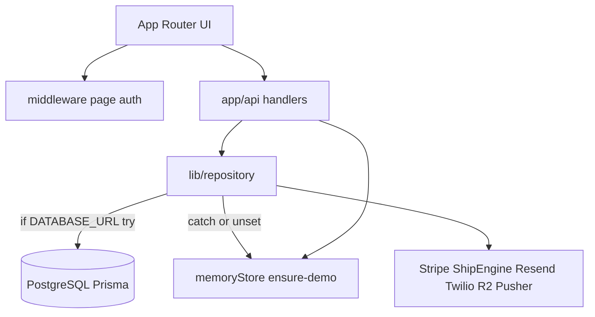
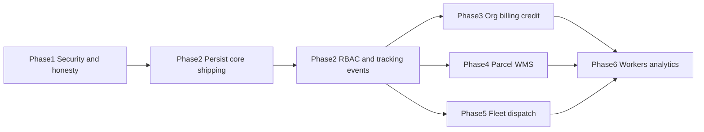

# NECO Ship Global — Phase 0 Complete Project Discovery and Technical Audit

**Status:** Audit-only complete. No source, schema, env, or deployment changes made.  
**Baseline:** `main` @ `23fc233` · remote `https://github.com/lisagumbeze-oss/necoshipglobal.com.git`  
**Live site:** https://necoshipglobalcom.vercel.app/  
**Working tree:** Uncommitted local changes preserved (`.env.example`, `app/(public)/page.tsx`, `cookie-consent.tsx`, `hero-routes-visual.tsx`, `prisma/schema.prisma`, plus untracked `public/images/hero/`, `scripts/`).  
**Safe checks run:** `npm run typecheck` — **passed** (exit 0). No installs, migrations, or destructive tests.

---

## CRITICAL SECURITY FINDINGS (separate from backlog)

These are production-risk items. Treat as **blockers** ahead of feature development.

### SEC-CRIT-1 — Default administrator auto-creation (Critical)

- [`lib/repository/users.ts`](lib/repository/users.ts): `ensureSeedAdmin()` runs on **module import** and again on every `authenticateUser`; creates `admin@necoship.global` / `Admin123!` and `demo@necoship.global` / `Demo1234!` with **no `NODE_ENV` / production guard**.
- If `DATABASE_URL` is set and admin email is absent, `createUser` **inserts into PostgreSQL**.
- Existence check is against **memory only**, not the database.
- Same credentials in [`prisma/seed.ts`](prisma/seed.ts) and published in [`README.md`](README.md).
- **Live impact:** Login page exposes a **Mock role** switcher (`Guest` / `Customer` / `Admin`). Default credentials remain in shipped source; any deploy that loads the users module can recreate known admins. Treat live as **likely compromised or compromisable** until credentials are rotated, auto-seed removed, and sessions invalidated.
- **Required remediation (Phase 1):** Remove runtime auto-seed; seed only via explicit, gated CLI in non-prod; rotate/invalidate known passwords; remove credentials from README; strip RoleSwitcher from production builds; force re-login after secret rotation.

### SEC-CRIT-2 — Silent database → memory fallback (Critical)

- [`lib/db.ts`](lib/db.ts): `isDatabaseConfigured()` is only `Boolean(DATABASE_URL)` — no health check.
- Repositories (`users`, `shipments`, `auth-tokens`, `audit`) **catch Prisma errors and fall through to in-process `memoryStore`**.
- Production risk: split-brain reads/writes, lost data on cold start, auth/password resets against ephemeral memory, ops dashboards that already read **memory-only** appearing “healthy” while Postgres is down.
- **Required remediation:** Fail closed in production when DB is required; surface 503; never write operational state to memory when `DATABASE_URL` is set; alert on Prisma failures.

### SEC-CRIT-3 — Default NextAuth secret (Critical)

- [`lib/env.ts`](lib/env.ts) and [`middleware.ts`](middleware.ts): fallback `"dev-nextauth-secret"`.
- `missingProductionSecrets()` exists but is **never called** — no startup fail-fast.
- **Required remediation:** Refuse boot in production without strong `NEXTAUTH_SECRET` + `DATABASE_URL`; rotate secret and invalidate all JWTs.

### SEC-HIGH (additional)

| ID | Issue |
|----|--------|
| SEC-HIGH-1 | `mapRoleToAppRole`: any non-`CUSTOMER` Prisma role → full app `admin` ([`lib/repository/users.ts`](lib/repository/users.ts)) |
| SEC-HIGH-2 | Middleware excludes `/api/*`; auth is per-route only ([`middleware.ts`](middleware.ts)) |
| SEC-HIGH-3 | Auth OTP/verification codes returned in JSON when `RESEND_API_KEY` unset |
| SEC-HIGH-4 | Carrier webhook `POST /api/webhooks/carriers` unauthenticated |
| SEC-HIGH-5 | Stripe webhook simplified / weak signature verification in dev path |
| SEC-HIGH-6 | OpenAPI claims `X-API-Key`; `requireSession` does not enforce API keys |
| SEC-MED-1 | `Math.random()` for auth tokens ([`lib/auth-tokens.ts`](lib/auth-tokens.ts)) |
| SEC-MED-2 | Demo fixtures (`ensure-demo`, fake API key hashes, webhook secrets) in authenticated flows |

**Do not publish** demo passwords in customer-facing materials. Credentials already appear in README/source — rotate assuming public knowledge.

---

## REPORT 1 — Executive Summary

**Condition:** Mature **UI prototype / design-system showcase** of an international logistics platform, not an operational TMS/WMS/fleet/billing system. ~65 API routes and ~65 App Router pages; Prisma schema (~38 models) is substantially richer than runtime persistence.

**Assessment:** Architecture choices (Next.js 14 App Router, Prisma 5.22, PostgreSQL, NextAuth, Zod, Tailwind, adapter pattern for Stripe/ShipEngine/etc.) are appropriate to retain. The gap is **persistence, RBAC, and operational domain wiring**, not framework selection.

**Strengths**

- Broad product surface: marketing, shipper dashboard, admin ops UI.
- Official NECO branding centralized (`#062853` / `#F8E000`) in [`lib/brand.ts`](lib/brand.ts).
- Meaningful schema foundation: Shipment, Package, TrackingEvent, Org, Warehouse*, DriverProfile, Invoice, Claim.
- Integration adapters with graceful local fallbacks when keys absent.
- Typecheck currently clean.

**Weaknesses**

- Default truth store is [`memoryStore`](lib/repository/memory-store.ts) + [`ensure-demo.ts`](lib/repository/ensure-demo.ts).
- Most domain APIs never touch Prisma even when DB is configured.
- No automated tests.
- Marketing claims (certs, stats, hubs, SaaS pricing) are placeholder and live on production.
- Package name still `swiftship-global`; dual domains (`necoshipglobal.com` vs `necoship.global`).

**Critical concerns:** SEC-CRIT-1/2/3; memory-backed ops data on serverless; unverified public claims; subscription pricing vs confirmed negotiated-credit B2B model.

---

## REPORT 2 — Technology Stack (actual)

| Layer | Technology | Version |
|-------|------------|---------|
| Frontend | Next.js App Router, React, TypeScript, Tailwind, Framer Motion, Sora/DM Sans | Next `^14.2.15`, React `^18.3.1`, TW `^3.4.13`, TS `^5.6.3` |
| Backend | Next.js Route Handlers (same app) | — |
| ORM / DB | Prisma + PostgreSQL | Prisma `5.22.0` |
| Auth | NextAuth credentials + optional Google; TOTP via otplib | `next-auth ^4.24.7` |
| Validation | Zod | `^3.23.8` |
| Payments | Stripe (adapter + local fallback) | `^17.7.0` |
| Carriers | ShipEngine (adapter + local rates) | env-gated |
| Maps / RT / mail / SMS / storage | Mapbox, Pusher, Resend, Twilio, R2/S3 SDK | optional |
| Testing | **None** | — |
| Deploy | Vercel (live); no `vercel.json`; `next.config.js` minimal | — |
| Package manager | npm (`package-lock.json`) | — |
| Package name | `swiftship-global` (legacy) | `1.0.0` |

---

## REPORT 3 — Repository Structure

```
app/(public)/     Marketing + quote/tracking/legal
app/(auth)/       Login, register, forgot-password, 2FA
app/(dashboard)/  Shipper + prototype /driver
app/(admin)/admin Ops console pages
app/api/**        ~65 Route Handlers
components/       design-system, public, brand, maps, providers
lib/auth*.ts      NextAuth, middleware helpers, tokens
lib/repository/   users, shipments, memory-store, ensure-demo
lib/services/     carriers, payments, wms, email, sms, realtime, audit…
prisma/           schema.prisma, seed.ts
public/brand/     Official logos
public/openapi.json  Partial API spec
```

**Entry points:** `app/layout.tsx` → route groups; auth gate in `middleware.ts` (pages only); data via `lib/repository/*` and `memoryStore`.



---

## REPORT 4 — Existing Feature Matrix

Status: A fully tested · B implemented untested · C partial · D mocked · E missing · F broken

| Feature | Status | Evidence | Recommended action |
|---------|--------|----------|-------------------|
| Authentication | C | NextAuth + hybrid users; prod demo seed | Harden (P0 security) |
| Registration / verify | C | APIs exist; weak verify UX | Complete + email-required in prod |
| Profiles | C | PATCH settings memory-only | Persist to Prisma User |
| Quotations | C/D | Quote API; memory; local/ShipEngine rates | Persist quotes; org rate cards |
| Shipment booking | C | Hybrid `bookShipment`; Package rows often not created | Full Prisma path + packages |
| Tracking | C | Public API; no provenance/dedupe; no live subscribe | Extend TrackingEvent |
| Multi-track | C | Up to 10 IDs | Keep; add rate limits |
| Pickup scheduling | D | Public page client id; admin memory | Wire Pickup + driver assign |
| Warehouse | D | SKU WMS in memory | Parcel custody model |
| Fleet / vehicles | E | No Vehicle model | New domain (extend carefully) |
| Drivers | D | Demo roster; schema DriverProfile unused by APIs | Bind to User + assignments |
| Dispatch | D | UI toast only | DeliveryAssignment APIs |
| POD | C | Memory + tracking event | Persist ProofOfDelivery |
| Corporate accounts | D | Org API memory; member userId bug | Org-first billing |
| Negotiated pricing | D | Rate cards/rules memory | Contract + RateCard relation |
| Credit accounts | D | creditLimit fields; no enforcement | CreditTerms + holds |
| Invoicing / payments | D | Memory invoices; User-scoped schema | Org invoices + aging |
| Claims / support | C | Memory tickets/claims | Persist + workflows |
| Notifications | D | Memory + adapters | Persist + channels |
| Admin dashboard | C | Rich UI on demo data | Back with Postgres |
| Staff management | D | GET-only fixtures | Real RBAC |
| Integrations | C | Adapters with stubs | Env-gated prod config |
| Reporting | D | Fixture series | Real aggregates |
| Automated tests | E | Zero test files | Introduce vitest + API tests |

---

## REPORT 5 — UI/UX Audit

**Live observations:** Homepage, About, Quote, Tracking, Locations, Login, OpenAPI, dashboard gate inspected.

**Strengths:** Consistent navy/yellow brand; Sora typography; sticky public nav; quote wizard; multi-track UI; cookie consent; Framer Motion; design-system primitives.

**Weaknesses / live issues:**

- Placeholder stats/certs/testimonials/SaaS pricing ($49/$129) on production homepage.
- Sample hubs presented as real network; contact geography inconsistent (e.g. Johannesburg vs locations list).
- **Mock role** switcher on live login — prototype UX in production.
- Dense public nav; duplicate homepage footers; undefined `brand-dark` token referenced.
- Maps often placeholder (not Mapbox-backed on locations/about).
- i18n scaffolding unused; English-only UI.
- Homepage animated counters can show broken values (e.g. `-0.0 M+`, `0 +`) during/after animation.

**Preserve branding:** Navy `#062853`, Yellow `#F8E000`, white/neutrals — already in `lib/brand.ts`. Do not publish unverified partnerships, stats, testimonials, or coverage.

---

## REPORT 6 — Database and API Audit

### Entities present (Prisma)

User, Account, Session, VerificationToken, Organization, OrganizationMember, CostCenter, Address, Quote, Shipment, Package, TrackingEvent, ProofOfDelivery, Exception, CustomsClearance, Pickup, DriverProfile, StaffProfile, RateCard, Surcharge, PromoCode, Invoice, InvoiceItem, Payment, Document, Ticket*, Notification*, ApiKey, Webhook*, AuditLog, Claim, BlogPost, WarehouseLocation/Bin/InventoryItem/Movement, CarrierIntegration, CarrierInvoice, SystemLog.

### Missing / incomplete for NECO ops

- **Fleet:** Vehicle, VehicleCategory, DriverVehicleAssignment, MaintenanceRecord, FuelExpense, Route/Stop, DeliveryAssignment, VehicleLocation.
- **Corporate:** Contract, CreditTerms, Statement, InvoiceApproval, org-scoped Invoice/Payment; RateCard↔Organization relation missing despite `organizationId` scalar.
- **Warehouse custody:** Package↔bin custody, PackageScan, Receiving, Transfer, DispatchManifest (EOD manifest is memory-only).
- **Tracking:** source, actorUserId, packageId, idempotencyKey on TrackingEvent.

### API reality

- **65** implemented routes; OpenAPI documents **~14** path groups — large under-documentation; overstated API-key auth.
- Prisma used mainly for users/shipments/tokens/audit/GDPR; quotes, invoices, warehouse, drivers, orgs, POD, tickets mostly **memory**.

---

## REPORT 7 — Fleet and Operations Gap Analysis

**Reusable now:** `DriverProfile`, `Pickup.driverId`, `WarehouseLocation`, `Shipment`/`Package`/`TrackingEvent`, `ProofOfDelivery`, `Exception`, staff UserRole enum values (underused).

**Do not duplicate:** Keep DriverProfile as the driver entity; extend Pickup rather than invent parallel “collection” entities; use TrackingEvent as the audit spine for operational milestones.

**Must add for own-fleet network:**

1. Vehicle registration/docs/categories/ownership/availability  
2. Driver↔vehicle assignment  
3. Maintenance/inspections  
4. Route/stop allocation + delivery assignments  
5. Fuel/operating costs (optional Phase 2+)  
6. Vehicle location (manual now; telematics later via event ingest)  
7. Utilization reports  

**Status distinctions (recommended):**

| Domain | Owner of truth |
|--------|----------------|
| Shipment status | Aggregate from packages + milestones |
| Package status | Scan/custody events |
| Vehicle status | Fleet availability/maintenance |
| Driver status | Duty/assignment on DriverProfile |
| Delivery status | DeliveryAssignment + POD attempts |

**Event ingest architecture:** Authorized staff actions, warehouse scans, delivery POD, carrier webhooks, and future telematics all write **TrackingEvent** (or linked PackageScan) with `source`, `actorUserId`, `idempotencyKey`; validate allowed status transitions; publish via Pusher optionally.

**GPS:** No telematics today — plan event-compatible `VehicleLocation` later; do not block Phase 1 on GPS vendors.

---

## REPORT 8 — Commercial and Financial Gap Analysis

**Confirmed model:** Negotiated corporate rates, contracts, credit terms — **not** public SaaS subscription as default.

**Exists:** Organization (+ creditLimitCents), RateCard (orphan org id), Invoice/Payment **per User**, demo wallet/auto-pay, memory rate-rules, homepage Enterprise “credit terms” teaser.

**Missing:** Contracts with validity; org rate lists; credit terms/limits enforcement at booking; credit holds; invoice approvals; aging/dunning; statements; credit notes; org-consolidated invoicing.

**Subscription pricing ($49/$129):** Recommend **remove from public homepage** or reposition as “platform access for API shippers” only after business confirmation — default commercial UX should be **Get a Quote / Talk to enterprise**, not monthly plans.

**Individual customers:** No corporate credit by default — keep prepaid/card/wallet separate from org credit accounts.

---

## REPORT 9 — Security and Deployment Audit

Covered in **Critical Security Findings** above.

**Infrastructure:**

- Vercel serverless suitable for web/API request/response; **not** ideal alone for long-running dispatch, scheduled invoicing, webhook retries, telematics ingest.
- Recommend: keep Next.js on Vercel; add managed Postgres (required in prod); queue/worker (e.g. Inngest/Trigger/Cloud Tasks + `lib/jobs`) for manifests, billing cycles, webhook delivery; R2 for files; Pusher for live updates.
- No evidence in-repo of backup/monitoring config — treat as open ops question.
- Per-instance memory store is **unsafe** on multi-instance Vercel.

**Env requirements:** See [`.env.example`](.env.example) — DATABASE_URL, NEXTAUTH_*, Stripe, ShipEngine, Mapbox, Resend, Twilio, R2, Pusher. Do not assume live keys are configured.

---

## REPORT 10 — Recommended Architecture (retain stack)

Retain Next.js 14 + Prisma + Postgres + NextAuth + Zod + existing adapters.

**Target layers:**

1. **Fail-closed data access** — Prisma repositories only in production; delete silent memory fallback when DB configured.  
2. **RBAC** — map Prisma `UserRole` + `StaffProfile.permissions` to fine-grained abilities (not binary admin).  
3. **Operational event bus** — TrackingEvent + PackageScan as system of record.  
4. **Org commercial core** — Contract → RateCard → Shipment → Org Invoice → Payment/Statement.  
5. **Fleet module** — Vehicle + assignments beside existing DriverProfile/Pickup.  
6. **Parcel WMS** — custody on Package, not only SKU InventoryItem.  
7. **Workers** — scheduled billing, webhook delivery, reconciliation off-request-path.

**Recommended internal roles (assessed):**

| Role | Maps from / notes |
|------|-------------------|
| Super Administrator | `ADMIN` — break-glass only |
| Operations Manager | `OPS_MANAGER` |
| Warehouse Manager | **add** (or permission set) |
| Warehouse Staff | **add** |
| Dispatcher | **add** (or OPS subset) |
| Delivery Agent | `DRIVER` + DriverProfile |
| Finance Officer | `FINANCE` |
| Customer Support Agent | `SUPPORT_AGENT` |
| Customs Officer | `CUSTOMS_OFFICER` (keep) |
| Read Only | `READ_ONLY` |

External: Individual customer, Corporate (org members: ORG_ADMIN / SHIPPER / BILLING / VIEWER), Recipient (token portal).

---

## REPORT 11 — Prioritized Development Backlog

### P0 — Critical (security & data integrity)

| Feature | Problem | Solution | Deps | Acceptance | Size | Risk |
|---------|---------|----------|------|------------|------|------|
| Remove auto admin seed | Known prod admin | Delete `ensureSeedAdmin` boot path; gated seed CLI only | — | No auto admin in prod; known passwords rotated | S | High if skipped |
| Enforce secrets | Weak JWT / no DB | Fail boot if missing `NEXTAUTH_SECRET`/`DATABASE_URL` in prod | — | App refuses start without secrets | S | High |
| Kill memory fallback in prod | Split-brain | Error 503 on Prisma failure when DB required | secrets | No silent memory writes in prod | M | High |
| Strip demo UI | Mock role live | Remove RoleSwitcher outside development | — | Login has no mock role in prod | S | Med |
| Rotate & invalidate | Exposed creds/secret | Password resets + NEXTAUTH_SECRET rotation | secrets | Old sessions invalid | S | High |
| Auth token CSPRNG | Weak OTP | `crypto.randomBytes` | — | Tokens use CSPRNG | S | Med |

### P1 — High (platform foundation)

| Feature | Problem | Solution | Size |
|---------|---------|----------|------|
| Persist core domains | Memory APIs | Repository rewrite: quotes, packages, POD, pickups, orgs, invoices | L |
| Real RBAC | Binary admin | Role→permission middleware for pages + APIs | M |
| TrackingEvent provenance | No audit | source, actor, packageId, idempotency, transition rules | M |
| Org billing v1 | User invoices only | organizationId on Invoice; credit check at book | L |
| Marketing claim cleanup | Unverified public claims | Remove stats/certs/SaaS tiers/fake hubs or mark TBD | M |
| OpenAPI + API keys | Spec lies | Sync spec; implement or drop X-API-Key | M |
| Test harness | Zero tests | Vitest for auth/repos + critical API routes | M |

### P2 — Medium (ops expansion)

Fleet vehicles/assignments, parcel WMS custody/scans, manifests dispatch, statements/aging, staff CRUD, webhook worker, live tracking subscribe.

### P3 — Low

Fuel analytics, telematics, i18n activation, CMS polish, utilization BI, advanced reconciliations.

---

## REPORT 12 — Phase 1 Implementation Proposal

**Do not start until project owner explicitly approves.**

### Objectives

1. Eliminate critical security defects on live deployment.  
2. Make production **Postgres-only** for authenticated/operational data.  
3. Remove prototype affordances and unverified commercial claims from public site.  
4. Establish RBAC skeleton and tracking event contract for later fleet/WMS/billing phases.

### In scope

- SEC-CRIT-1/2/3 and related HIGH auth hardening.  
- Production boot validation; session invalidation procedure.  
- Remove/hide RoleSwitcher, README credentials, demo password paths.  
- Public content hygiene: stats, certifications, testimonials, subscription teaser, sample locations disclaimers or removal.  
- Fix `brand-dark` token / footer.  
- Introduce minimal test suite for auth seed absence + fail-closed DB behavior.  
- Document runbooks: admin provisioning, secret rotation, env checklist.

### Out of scope (later phases)

- Full fleet module, parcel WMS, complete org credit/aging, telematics, subscription product decisions beyond removing misleading homepage tiers.

### Technical dependencies

- Confirmed production `DATABASE_URL` and ability to rotate `NEXTAUTH_SECRET` on Vercel.  
- Owner-approved admin provisioning method (invite / CLI one-shot).  
- Decision on whether demo accounts may exist in non-prod only.

### Database preparation

- No broad schema expansion required for Phase 1 security.  
- Plan migration **only if** adding columns for TrackingEvent provenance early; otherwise defer to Phase 2.  
- Manual: delete/rotate known admin/demo users in prod DB after deploy.

### Security considerations

- Assume default passwords public; force reset.  
- Disallow OTP leakage without Resend in production.  
- Sign carrier/Stripe webhooks before enabling in prod.

### Development tasks (milestone-sized)

1. Security patch PR (seed, secrets, fallback, role switcher, CSPRNG).  
2. Vercel env audit + secret rotation (ops).  
3. Marketing/content honesty PR.  
4. Auth/RBAC skeleton PR (stop non-CUSTOMER → full admin).  
5. Smoke tests + typecheck/lint gate.

### Testing strategy

- Unit: `missingProductionSecrets`, no `ensureSeedAdmin` in production mode, repository throws when DB down in prod.  
- Manual: login, register, tracking GET, admin denied for customer.  
- No dependency installs beyond existing tooling if possible; add vitest only with approval.

### Phase 1 acceptance criteria

- [ ] Production build fails or refuses traffic without `DATABASE_URL` + strong `NEXTAUTH_SECRET`.  
- [ ] No automatic creation of default admin/demo users.  
- [ ] Known default credentials cannot authenticate (rotated/removed).  
- [ ] No Mock role control on production login.  
- [ ] Prisma failures do not write to memory in production.  
- [ ] Public homepage does not show unverified certs/stats/SaaS prices (or clearly non-claim disclaimers per owner).  
- [ ] Typecheck passes; critical unit tests pass.  
- [ ] Owner sign-off before Phase 2 (persistence / fleet / billing).

---

## REPORT 13 — Open Business Questions

Architecture-affecting only:

1. **Admin provisioning:** Who is the first Super Admin, and by what secure process?  
2. **Production database:** Is Postgres already attached on Vercel? Who operates backups?  
3. **Own-fleet scope v1:** Which countries/hubs are real vs future? Which vehicle categories first?  
4. **International linehaul:** Carrier partners vs NECO-operated segments — what must the system orchestrate vs track only?  
5. **Corporate credit:** Standard terms (Net 15/30/45), who approves limits, who approves invoices?  
6. **Individual vs corporate UX:** Keep consumer shipper flows or prioritize B2B-only initially?  
7. **Subscription tiers:** Remove entirely, or retain as optional API platform fee separate from freight?  
8. **Real facilities:** Confirm or replace LAX/FRA/DXB/SIN/ORD and Johannesburg contact claims.  
9. **Certifications:** Any real credentials that may be published?  
10. **Currency / legal entity / tax:** Invoicing currency, VAT/tax handling, contracting entity name (“Neco Ship Global” vs product name).  
11. **Background jobs host:** Preferred worker platform alongside Vercel?  
12. **Uncommitted local work:** Should WIP hero/cookie/schema changes be merged before Phase 1 security PR?

---

## Scrum sequence (recommended)



**Must-have before go-live as logistics platform:** P0 security, Postgres persistence for shipments/packages/tracking/users/orgs, RBAC, org invoicing basics, pickup/delivery assignment MVP.  
**Later:** Full WMS, fleet maintenance/fuel, telematics, advanced reconciliation.

---

## Phase 0 completion checklist

- [x] Repository inspected  
- [x] Live website assessed (public routes + auth gate; no unauthorized credential use)  
- [x] Feature matrix classified  
- [x] Stack identified  
- [x] Database/API assessed  
- [x] Fleet/logistics gaps evaluated  
- [x] Corporate pricing/invoicing evaluated  
- [x] Security/infrastructure reviewed  
- [x] Prioritized backlog created  
- [x] Phase 1 proposal presented  
- [x] Open questions documented  

**STOP:** Awaiting explicit project owner approval before any Phase 1 implementation.
